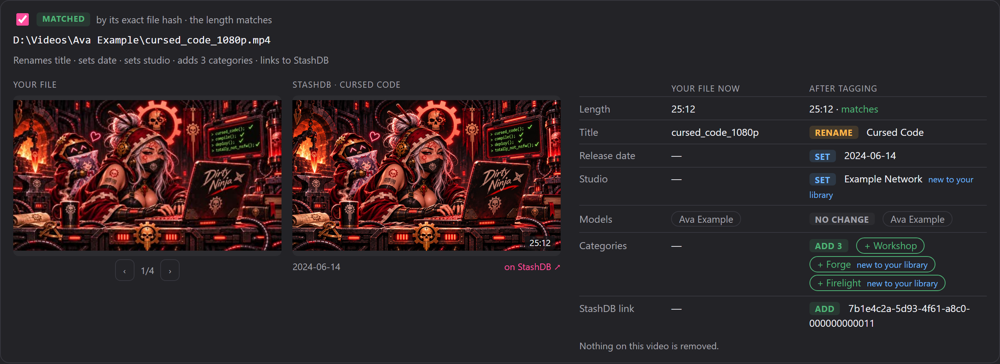
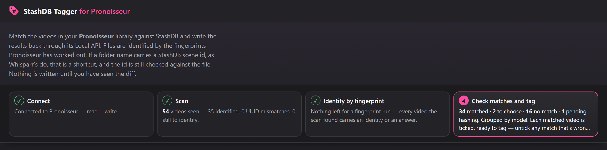
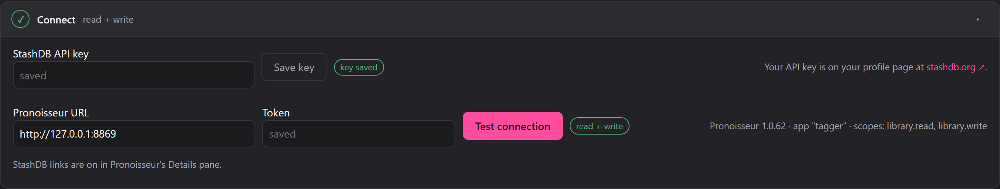
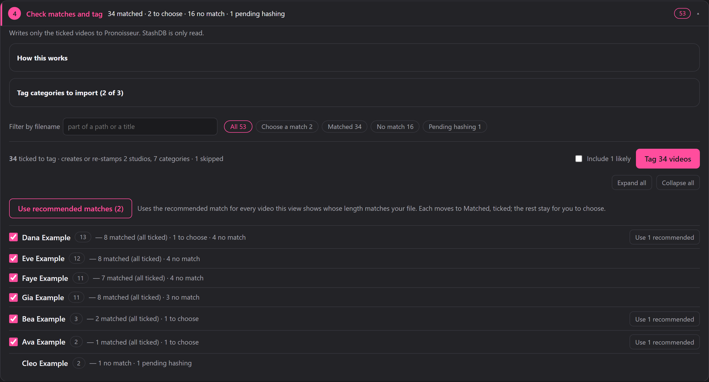
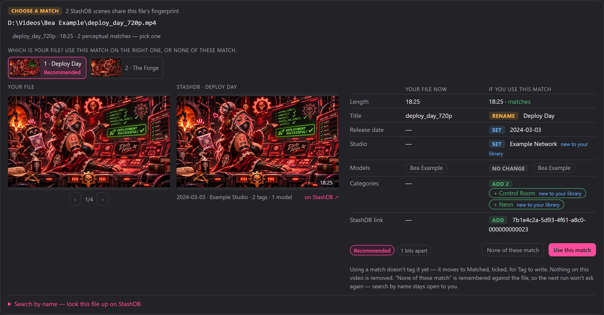

# StashDB Tagger for Pronoisseur

A small local web tool that matches the videos in a [Pronoisseur](https://pronoisseur.com/) library against [StashDB](https://stashdb.org/) and writes the results back into Pronoisseur through its Local API. You see a diff of every change before anything is written.

Pronoisseur is a multi-monitor video wall player for Windows, and this tool needs it installed. Get it at [pronoisseur.com](https://pronoisseur.com/).



*A matched video: a frame from your file beside the StashDB cover, and every field tagging will change. The screenshots here show a demo library with invented names and stand-in pictures.*

## What it does

- Reads your video list from Pronoisseur.
- Identifies each file against StashDB using the fingerprints (oshash and phash) Pronoisseur has already computed for it. The tool never hashes a file itself.
- Asks you to review the matches it is unsure about, grouped by model, with a frame from your own file beside each StashDB cover.
- Writes the title, release date, studio, models and categories from the matched StashDB scene, and records the StashDB scene id on the video.

## What it needs

- Python 3.11 or newer. It uses only the standard library.
- A [StashDB](https://stashdb.org/) account and an API key.
- A [Pronoisseur](https://pronoisseur.com/) release with fingerprints (1.0.62 or later), with the Local API enabled and a connected app token (see below). An older Pronoisseur still connects, but every video it has no fingerprint for is listed as Pending hashing.
- Optional: `ffmpeg` and `ffprobe` on your PATH, only so Review can show a frame from your own file beside each StashDB cover.

## Install and run

```
python run.py
```

This starts the server and opens `http://127.0.0.1:8426/` in your browser. It listens only on this computer. Other options:

- `python run.py --no-open` serves without opening a browser tab.
- `python run.py --check` tests both connections, then exits.
- `python run.py --config path/to/config.json` uses a different config file.

Identification uses the fingerprints Pronoisseur computes. The quick one (oshash) is always on and recognises a byte-identical file. To also match re-encoded or trimmed copies, turn on **Fingerprint videos for connected apps** in Pronoisseur's Settings → Local API, which adds a perceptual hash (phash). A video with no fingerprint to look up is listed as **Pending hashing**; it is never tagged, and the next Scan and Identify pick up whatever Pronoisseur has computed since. A StashDB scene id in a folder name is a separate source of identity, read at Scan, and works either way.

## The four steps

There are no setup files to edit. The strip at the top highlights the step you are on and dims the ones that are waiting on an earlier step. It is a guide, not a lock: Identify and Check matches and tag can be highlighted together while a run goes on, and the one hard requirement is that Scan and everything after it need both credentials.



1. **Connect.** Paste your StashDB API key, the Pronoisseur address (pre-filled with `http://127.0.0.1:8869`) and a Pronoisseur token. Each value is tested before it is saved. If a test fails, the value you had saved is kept, but a failed Pronoisseur test drops the live connection until you retry.
   - StashDB key: on your profile page at [stashdb.org](https://stashdb.org/).
   - Pronoisseur token: in Pronoisseur, Settings → Connected apps → Enable → Add app → tick "Update video metadata" → copy the token, which is shown once. Pronoisseur's [Connected apps help](https://pronoisseur.com/help/14-connected-apps/) has the same steps in full.
   - A read-only token still connects. You can check the matches, but Tag stays disabled.
   - With a write token, Connect and every Tag run also register StashDB link patterns with Pronoisseur (1.0.62 or later), so the ids the tool writes show as links in Pronoisseur's Details pane, including on videos tagged before. The Connect step says whether that worked.
   - If the test can't reach Pronoisseur, look at the line under "Enable the Local API" in Settings → Connected apps. Windows can reserve blocks of ports for itself, for example for Hyper-V or WSL, and Pronoisseur then reports that the port is in use even though no program has it. Change Port there to a different number, such as 28869, and use the same number in the address here.

   
2. **Scan.** Reads the library from Pronoisseur and sorts the videos into groups by what is already known about them. A scan always covers the whole library: nothing is read from your files, so even a large library takes minutes.
3. **Identify by fingerprint.** Takes the fingerprints Pronoisseur gave at Scan and asks StashDB which scenes they belong to. No file is opened or hashed, so a large library takes minutes rather than hours. Results are looked up in small batches, so you can check and tag them while the run continues. Files the run has not reached yet stay out of the list until it does. When it finishes, the line above the list says how many videos had a perceptual hash and how many are pending.
4. **Check matches and tag.** One list of every video the run found something about, grouped by model, using the models the video already has and the cast of the scene StashDB matched it to. A short "How this works" box sits at the top; fold it away and it stays folded.

   

   Each video is one of four kinds:
   - **Matched:** the tool found its StashDB scene, and the card says how, for example "by its exact file hash · the length matches". It is ticked, ready to tag. Your file's frame sits beside the StashDB cover, both the same size, with what tagging does to each field. Untick any match that's wrong.
   - **Choose a match:** StashDB has more than one scene that could be this video, or one that is not close enough to be sure. Each match is a tab beside your frame; **Use this match** on the right one, or **None of these match**. A video you choose moves to Matched, ticked.
   - **No match:** StashDB has no scene with that fingerprint. Search for it by name.
   - **Pending hashing:** Pronoisseur has no perceptual fingerprint for this video yet, and its exact one found nothing. The card says why: Pronoisseur hasn't reached the file or couldn't read it, its perceptual fingerprints are switched off, or the version is too old to share fingerprints. Search for it by name, or scan and identify again later.

   

   The tick beside a model ticks or unticks every matched video in that group, so a whole model can be tagged without opening it. **Use recommended** takes the recommended match for every video in a group (or, from the top of the list, in every group), and only where its length agrees with the file. A video with two models is in both groups, and one tick or answer covers both. Chips narrow every group to one kind, and Expand all / Collapse all open or shut every group. **Tag** writes the ticked videos only after a confirmation with the totals. Both buttons follow the view: the chips and the filename filter narrow Tag and Use recommended exactly as they narrow the list, so a ticked video the filter hides is counted as not tagged rather than sent. Under Choose a match, No match and Pending hashing there is nothing to tag, so there is no Tag button. The frames are the one thing read from your files: they are taken with ffmpeg the first time they are shown and kept in `tagger-frames/` beside the state database. A frame needs the file; the write does not. If a file's drive is offline, its card says so (for example "Z: is not reachable") and the tool waits a minute before looking again, and writing to Pronoisseur works as normal. Folder names that carry a StashDB scene id, as Whisparr's do, are used as a shortcut and are checked against the file by duration. A video with no duration to compare is left unverified, and is written only if you include it. Where the folder id and the fingerprints disagree, the video is listed so you can decide.

## What it writes

To Pronoisseur, for each video you write:

- title, release date (and the flag marking it estimated when StashDB only dates the scene to a year or month), studio, models, categories, and the StashDB scene id. Models and categories are add-only: it adds the ones the scene has and never removes any you already have.
- New models, studios and categories are created in Pronoisseur if they do not exist yet. An existing one is stamped with the scene's StashDB id when it has none or a different one; a category you mapped onto one of your own is never stamped.
- Categories are written only after you pick tag categories on the page. The list of chosen categories starts empty, so until you choose some, no category is added.
- Performer aliases from StashDB are added to Pronoisseur's alias list.

## What it never does

- Writes a change to a video without showing it to you first. Each matched video shows every field, what is in it now, and what tagging does to it: rename, change, set, replace, add, or no change. Models, studios and categories that are new to your library are marked. The totals of entities created or re-stamped, and of alias rows, appear above the list and again in the confirmation.
- Moves, renames, deletes or edits your video files.
- Removes models or categories from a video.
- Writes anything to StashDB. It only reads.
- Contacts Whisparr. Folder names are only read for a scene id.
- Accepts requests from other websites. Requests carrying a foreign `Origin` are refused, POSTs must be JSON, and the Pronoisseur address must be on this computer.
- Sends your keys anywhere except the service they belong to. They are never shown back in the page.

## Where its data lives

Both files sit next to `run.py` and are ignored by git.

- `config.json` holds the StashDB key and Pronoisseur token in plain text, along with the address and a few settings. The page writes it for you. Values can also be set with `TAGGER_` environment variables, for example `TAGGER_STASHDB_API_KEY`, which win over the file.
- `tagger-state.db` is a SQLite file holding match decisions, cached scenes, the tag-category list and a log of what was written. It never holds a key or token.

Deleting `tagger-state.db` loses your decisions and cached scenes; it does not change anything in Pronoisseur.

## Checking StashDB still behaves

`python scripts/smoke.py` runs three read-only checks against StashDB with the saved key: authentication, the page-size cap and the shape of a scene. It exits 2 if no key is configured.

## Tests

```
python -m unittest discover -s tests
```
